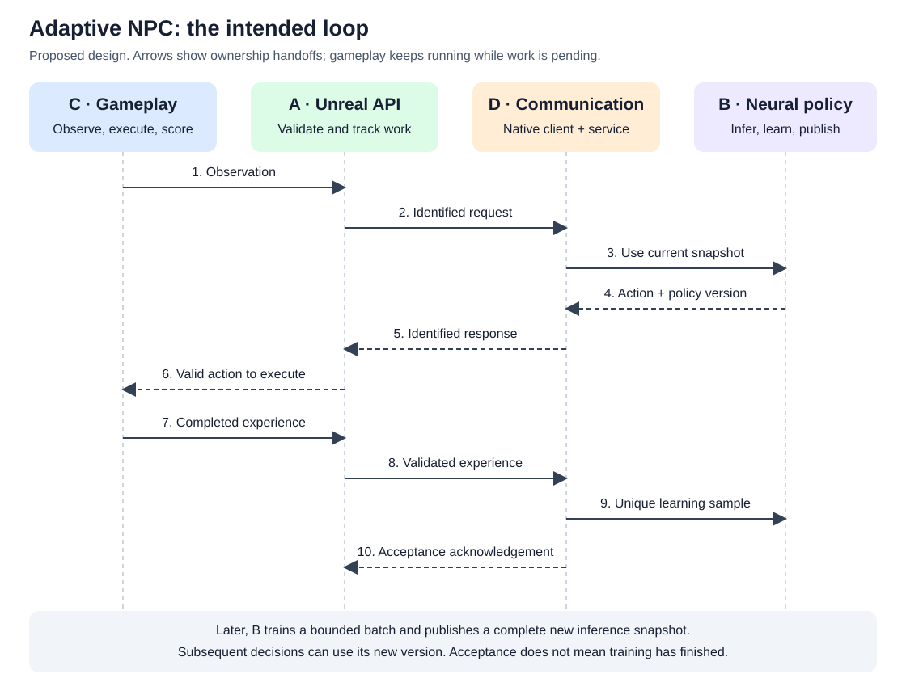

Adaptive NPC Online Learning: Proposed Contract
============================================================

.. important::

   **Status: design proposal for team review.** This page describes the intended
   live learning integration; it does not add that functionality. The
   choices below are recommendations until the affected owners confirm them.
   The review checklist at the end records what remains open.

Purpose and starting point
--------------------------

An adaptive NPC should learn from outcomes during a game session and use its
updated neural policy for later decisions. A policy is the rule that chooses an
action from an observation. An observation describes what the NPC can perceive;
an action is a command the game can execute. An experience records a decision
and its outcome, including reward and the next observation.

The merged NPC selection API already exposes five paradigms. Its Adaptive path
is currently a mock: it remembers a supplied preferred action for an identical
observation. It does not train a neural model, and its ``LearningUpdates`` counter
counts submitted mock feedback. The other four paradigms also remain mocks.

Schola already supplies numerical point and space types, game interaction
interfaces, Python training integrations, and inference with exported ONNX
models. The proposed addition connects live gameplay experience to a Python
learner while keeping the game responsive.

Proposed first release
----------------------

Start with one adaptive NPC, one outstanding decision request, and a local
Python process, with gameplay experience kept local. Use numerical observations
and bounded continuous movement commands in a small pursuit example. Reuse
Stable Baselines 3 (SB3) Soft Actor
Critic (SAC) for neural learning, subject to B and C confirming the algorithm and
supported spaces. SAC can learn from stored experiences produced by earlier
versions of the policy.

Use the same observation, action, and reward meanings for pretraining and live
play. Keep learning across encounters within a session. B owns explicit
checkpoint saving and documents which model, preprocessing, and replay-buffer
state can be restored. A checkpoint is a saved learning state; the replay buffer
is a bounded store of past experiences used in training batches.

Standalone learning without Python, live replacement of ONNX assets, multiplayer,
large NPC batches, additional algorithms, and changes to the other four
paradigms are outside this first release.

Who owns each part
------------------

.. list-table:: Responsibilities and handoffs
   :header-rows: 1
   :widths: 12 35 53

   * - Owner
     - Owns
     - Supplies to the rest of the team
   * - A: Unreal integration
     - Public policy API, data records, validation, pending work, lifecycle,
       and status reporting.
     - A safe way for C to request decisions and submit outcomes through D's
       client. A does not move actors, calculate rewards, or train the model.
   * - B: neural learning
     - Starting model, experience-to-training integration, neural updates,
       inference snapshots, policy versions, and checkpoints.
     - Supported data requirements, actions from a neural policy, and truthful
       learning progress. B reuses SB3 rather than implementing a new algorithm.
   * - C: gameplay
     - Host demo, observations, action execution, rewards, encounter endings,
       and the adaptive gameplay coordinator.
     - Observations and completed experiences describing what actually happened.
       C chooses safe gameplay behavior while a decision is pending or fails.
   * - D: communication and evaluation
     - Message schema, native client, Python service boundary, deadlines,
       acknowledgements, and shared evaluation/setup documentation.
     - Nonblocking request completion, delivery status, and learner diagnostics.
       D's communication workers do not access game actors.

The intended gameplay and learning loop
--------------------------------------------------

         messages with B's neural policy. The action returns through D and A to
         C. C executes it and sends its completed outcome through A and D to B.
         D acknowledges accepted experience; B later trains and publishes a new
         inference snapshot for subsequent decisions.
   :width: 100%

   Decision requests and completed experience follow the same ownership chain.
   Experience acknowledgement and neural training are separate events.

1. **C observes the game.** At a decision boundary, C collects the agreed
   observation and asks A's API for an action.
2. **A validates and tracks the request.** A checks readiness and the observation,
   assigns a decision ID, and passes copied numerical data to D without waiting
   on the game thread.
3. **D delivers it to B's inference snapshot.** The service checks the session
   and routes the request. A snapshot is a complete, read-only copy of the part
   of B's neural model that chooses actions.
4. **B returns an action and its policy version through D.** A checks the reply's
   identifiers, action values, and age before releasing it to C. Waiting or
   failure does not overwrite the caller's action output.
5. **C executes and measures the outcome.** C records the command actually
   applied, accumulates reward over its decision interval, and captures the next
   observation and encounter-ending flags.
6. **A validates the completed experience; D delivers it for acceptance.**
   A queues valid experience within a fixed capacity. D acknowledges acceptance
   by the Python service separately from local queue acceptance.
7. **B learns later.** B adds accepted experience to its learning pipeline and
   runs bounded training batches. One submitted experience does not imply one
   optimizer update. After an update, B publishes a complete new snapshot; later
   decisions can report its new version.

C keeps the game responsive throughout this loop. B keeps a snapshot unchanged
while inference uses it, so a request cannot read partially updated weights.
In-flight requests may finish using an earlier snapshot.

Shared records
--------------

A owns the Unreal records; D owns their message representation. Define both
together so fields keep the same meaning on either side of the connection.
Reuse Schola's ``FPoint`` types for values and ``FInteractionDefinition`` for
declared observation and action spaces.

.. list-table:: Proposed identifying fields
   :header-rows: 1
   :widths: 25 75

   * - Field
     - Meaning
   * - Session ID
     - Identifies one live learner connection. A fresh configuration or
       reconnection must not reuse identifiers from the previous session.
   * - Agent ID
     - Identifies the NPC, even though the first release supports only one.
   * - Episode ID
     - Identifies the encounter. An encounter reset advances this ID while
       keeping the learning session and its learned model.
   * - Decision ID
     - Matches a request, its result, and its completed experience. Do not reuse
       a decision ID within a session.
   * - Policy version
     - Identifies the inference snapshot that produced the action. This is
       attribution, not a requirement that every reply use the newest version.

``FAdaptiveDecision`` is the proposed result record: identifying fields and the
returned action. A retains the originating observation and request timing for
validation. The team must agree exact identifier types and who assigns the
session ID during the handshake.

``FAdaptiveExperience`` is the proposed real learning record. It contains the
identifying fields, originating observation, executed action, finite reward,
next observation, and separate ``Terminated`` and ``Truncated`` flags.
Termination means the task ended; truncation means an external limit or
interruption ended the encounter. Preserve the final observation before reset.
B confirms the learner's treatment of these flags.

Executed action means the command applied through gameplay, not the actor's
measured displacement. C must never attribute an unrelated fallback command to
a remote action. B and C must agree whether modified commands are supported and
how to represent or bound the delay between observation and execution.

Illustrative shared example
~~~~~~~~~~~~~~~~~~~~~~~~~~~

This example is a fixture proposal, not the final pursuit observation layout.
Assume four normalized observation values and two movement commands in
``[-1, 1]``. C still defines the actual dimensions, units, and reward function.

.. code-block:: text

   Request:
     Session = demo-session-01, Agent = 1, Episode = 7, Decision = 42
     Observation = [0.50, -0.25, 0.10, 0.00]

   Result:
     Same Session, Agent, Episode, and Decision
     PolicyVersion = 4, Action = [0.30, -0.10]

   Completed experience, after C applies that command:
     Same identifiers and PolicyVersion = 4
     Observation = [0.50, -0.25, 0.10, 0.00]
     ExecutedAction = [0.30, -0.10], Reward = -0.25
     NextObservation = [0.45, -0.20, 0.10, 0.00]
     Terminated = false, Truncated = false

The negative reward is valid learning data. Submitting this record does not
increment a neural-update counter. A duplicate delivery with the same
session/agent/episode/decision identity must not create another learning sample;
a conflicting payload for that identity must be reported as an error.

Public calls and observable behavior
------------------------------------

The existing ``UNPCInferencePolicy`` remains the public entry point. Its Adaptive
path delegates to the proposed ``UAdaptiveNPCPolicy``. New names below are
proposals; existing names refer to the merged API.

.. list-table:: Proposed call contract
   :header-rows: 1
   :widths: 27 73

   * - Operation
     - Required behavior in live Adaptive mode
   * - ``Configure`` (existing)
     - Validate configuration before replacing valid state. Successful
       reconfiguration invalidates old work and requires initialization again.
   * - ``Init`` (existing)
     - Validate supported spaces and begin the session handshake. Success means
       local initialization started; readiness is reported separately.
   * - ``RequestDecision`` (new)
     - Accept a valid observation only when ready and capacity is available.
       Return a decision ID without waiting for the remote action.
   * - ``TryGetDecision`` (new)
     - Distinguish pending, ready, failed, and cancelled work. Return an action
       only for a valid ready result. C tracks whether it has already applied it.
   * - ``SubmitExperience`` (new)
     - Validate and locally queue a completed experience once. Report rejection
       or queue-full explicitly. Local acceptance is not remote acknowledgement.
   * - Session status (new)
     - Distinguish connecting, ready, failed, and stopped sessions. Separately
       expose an actionable failure reason.
   * - ``IsInferenceBusy`` (existing)
     - Report outstanding inference. A false value does not by itself mean the
       session is ready; callers also check session status.
   * - ``GetStats`` (existing)
     - Distinguish local acceptance, remote acknowledgement, and B-reported
       neural updates/policy versions. Counter layout and unavailable/stale
       status representation remain open.
   * - Encounter reset (new operation)
     - Invalidate outstanding encounter actions and advance the episode ID.
       Preserve the learning session and track already accepted experience.
   * - Shutdown (new operation)
     - Stop accepting work, invalidate callbacks, and close the connection
       safely. Report any experience that cannot be acknowledged.

Keep ``IPolicy``, ``Think``, and ``BatchedThink`` signatures. Recommend that live
Adaptive calls to the immediate inference methods fail promptly with a useful
diagnostic directing callers to the request/result API; they must leave action
outputs unchanged. Confirm this restriction with shared API owners. C's new
coordinator uses the completion-based API. Existing simple and pipelined
steppers are not the live adaptive coordinator.

Compatibility with the merged mock
-----------------------------------

Preserve ``FPlayerBehaviorFeedback`` and ``SubmitFeedback`` signatures. Preferred
actions describe the old mock and are not completed reinforcement-learning
experience. Introduce ``FAdaptiveExperience`` and ``SubmitExperience`` separately.

The recommended compatibility behavior is an explicit mock/live Adaptive
configuration choice: preserve existing mock use for current callers, and
require an explicit selection for live learning. In live mode, reject legacy
``SubmitFeedback`` with a clear diagnostic. Confirm the option's name and default
with shared API owners before implementation. Do not silently switch existing
Blueprints to a remote service or silently train on preferred-action hints.

The other four paradigms retain their current behavior and tests. The existing
mock ``LearningUpdates`` value remains a mock diagnostic; the live mode must
identify learner-reported updates separately and document their meaning.

Validation, lifecycle, and delivery rules
--------------------------------------------------

* Reuse existing space validation for types, dimensions, and bounds. Add checks
  for identifiers, supported definitions, and nonfinite values where needed.
  A validates API data, D validates incoming messages, and B checks compatibility
  with the learner; a valid Unreal call does not replace service validation.
* Reject a result for a different session, NPC, episode, cancelled request, or
  expired decision. Measure request age with Unreal's local elapsed-time clock;
  do not subtract unrelated clocks across the two processes.
* Do not reject an otherwise valid result solely because its policy version is
  older. Retain that version in the experience record.
* C owns action duration, pending/failure fallback, reward boundaries, and final
  observation capture. Agree how observation-to-execution delay fits the task;
  do not mix rewards earned by previous actions or fallback behavior into the
  remote action's experience without an explicit learning contract.
* At encounter end, C finishes and submits the last experience before reset.
  Reset cancels old actions but does not discard already accepted terminal
  experience. A can match its later acknowledgement to the original record.
* A bounds its outstanding work and experience queue; D bounds service input.
  Queue-full stops new learning decisions and exposes the failure to C. Neither
  layer silently drops accepted data. Retire completed request history so a long
  session does not grow memory without limit.
* D acknowledges after validation, duplicate checking, and acceptance into a
  bounded Python learning input. This does not promise an optimizer update or
  durable storage across a Python crash. Retries keep the same identity; D/B
  ensure duplicate acceptance cannot insert a second sample. On session loss,
  report unacknowledged work and do not automatically resend it into a new
  session. Agree retry limits and recovery policy before wiring the client.
* A changes Unreal object state on the game thread. D's workers use copied data
  and have no actor access. Late completions after reset or destruction cannot
  mutate a new session or a destroyed object. Network waits and Python
  optimization never block a game-thread API call.

Implementation boundaries and independent work
----------------------------------------------

The filenames below are proposed additions, except the existing public facade.

.. list-table:: Component map
   :header-rows: 1
   :widths: 10 40 50

   * - Owner
     - Component
     - Location
   * - A
     - Existing ``UNPCInferencePolicy``; new shared records and adaptive bridge.
     - ``Source/ScholaInferenceUtils/.../Policies/``;
       shared records in ``Public/Policies/AdaptiveLearningTypes.h``.
   * - C
     - ``UAdaptiveNPCStepper`` and pursuit demo.
     - ``Source/ScholaInferenceUtils/.../Steppers/`` and
       ``Examples/AdaptiveNPCs/``.
   * - D
     - ``FAdaptiveRPCClient``, messages, and Python service/launch command.
     - ``Source/ScholaProtobuf/.../Adaptive/``,
       ``Proto/AdaptiveLearning.proto``, and ``Resources/python/schola/adaptive/``.
   * - B
     - ``AdaptiveSACTrainer`` and checkpoint/snapshot support.
     - ``Resources/python/schola/adaptive/trainer.py``.

A can implement validation, pending work, lifecycle, and public routing against
controlled test responses. B can use recorded experience; C can use a fixed
policy; D can use fixed service responses. These prove individual boundaries,
not real neural learning. Agree a concrete client contract without introducing
a general transport or learner framework just to support test doubles.

A's inference module may privately depend on ``ScholaProtobuf``. D's client must
not depend back on ``ScholaInferenceUtils`` or its policy records. Use existing
Schola types and D-owned message representations at that boundary, with mapping
in A's implementation. Keep gRPC details out of public policy headers.

Review checklist before dependent implementation
------------------------------------------------

All entries are **open** in this proposal. Record the resulting decisions in
this page through review; do not interpret document publication as team approval.

.. list-table:: Decisions to confirm
   :header-rows: 1
   :widths: 20 80

   * - Owners
     - Decision and recommended starting point
   * - B, C
     - Confirm SAC; numerical observations and bounded continuous actions;
       exact dimensions, units, preprocessing, and action scaling.
   * - B, C, A
     - Define decision/reward intervals, handling of inference delay and
       modified commands, terminal observations, and truncation behavior.
   * - A, D, B
     - Freeze record/message fields, identifier types and assignment,
       policy-version meaning, and counter semantics using one shared fixture.
   * - A, D
     - Freeze native client methods, completion threading, readiness, timeout,
       cancellation, queue capacity, retries, acknowledgement, and recovery.
   * - A, C
     - Confirm coordinator call order, result consumption, encounter ending,
       and safe pending/failure behavior. Set provisional configurable limits;
       measure and freeze latency/fallback thresholds at integration.
   * - A and shared API owners
     - Confirm additive experience calls, explicit mock/live selection and its
       default, legacy feedback behavior, and immediate-inference restrictions.
   * - B, D
     - Define experience acceptance versus replay insertion, real update counts,
       immutable snapshot publication, checkpoint contents, and frozen evaluation.

Acceptance evidence
-------------------

Each owner tests their own implementation. A's tests must cover invalid spaces
and values, pending/failed outputs, wrong and expired replies, reset/destruction,
negative rewards, duplicates, queue capacity, truthful stats, and regressions in
the other paradigms. D additionally tests real round trips, acknowledgements,
duplicate delivery, and connection failure. C tests action/reward timing and
encounter endings; B tests replay insertion, actual neural updates, and snapshots.

Integrate in three gates:

1. **Real inference:** execute a valid neural action in Unreal and record its
   correctly attributed outcome, with updates disabled. Set measured latency
   and fallback limits.
2. **Real learning:** prove accepted gameplay experience reaches a training
   batch, the published actor parameters change, and later decisions identify
   a new snapshot. Reset and shutdown remain safe during this run.
3. **Adaptation:** D coordinates repeated, predeclared seeded comparisons
   against the same starting policy kept frozen. C supplies the player-pattern
   change; B records learning and exploration settings. Report pursuit success,
   recovery, latency, rejected experience, and fallback frequency. Weight
   changes alone do not establish improved behavior.

A's integration is complete when C can use the documented API to receive valid
decisions, submit correctly attributed experience, reset safely, and handle an
unavailable learner without freezing gameplay. The team claims validated
adaptation only if the comparison supports it. Another teammate must be able to
follow the published setup and reproduce the procedure.
