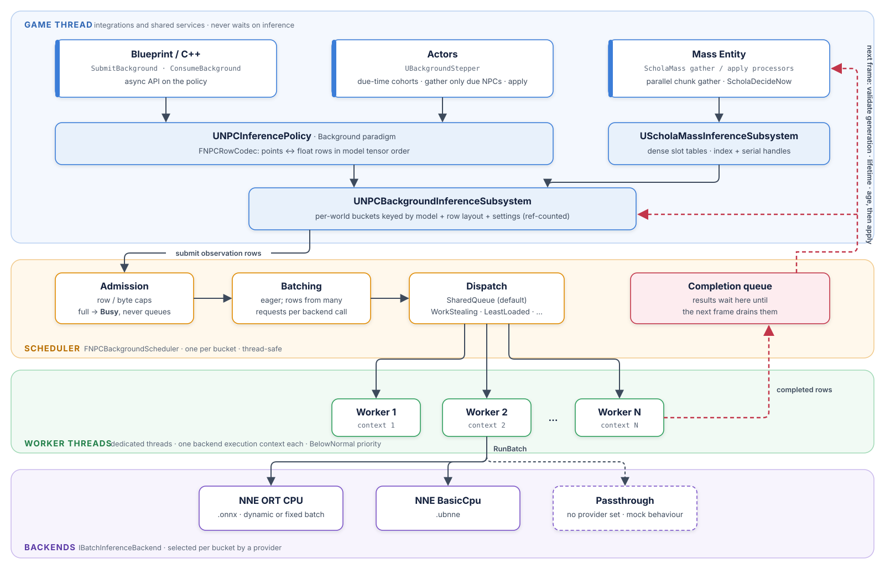

NPC Inference Paradigms
======================

``ScholaInferenceUtils`` exposes ``UNPCInferencePolicy`` in
``Policies/NPCInferencePolicy.h``. Select one of five paradigms with
``FNPCInferenceConfig::Paradigm``. It implements the existing ``IPolicy``
interface, so callers can use ``Think``, ``BatchedThink``, and existing steppers.
The same methods are Blueprint-callable; they do not add a UI or training gRPC endpoints.

Background inference uses bounded batching and dedicated workers with an NNE CPU
provider. The other four paradigms remain deterministic prototypes. Their copied
points stand in for actions. ``UNNEPolicy`` is unchanged.

Construction and selection
-------------------------

Add ``ScholaInferenceUtils`` to your module dependencies. Hold the policy in a
``UPROPERTY`` or another Unreal GC-safe owner, as with other UObject policies.

.. code-block:: cpp

   #include "Policies/NPCInferencePolicy.h"
   #include "Points/BoxPoint.h"

   TInstancedStruct<FPoint> Behavior, PreferredAction, Action;
   Behavior.InitializeAs<FBoxPoint>(TArray<float>{1.0f});
   PreferredAction.InitializeAs<FBoxPoint>(TArray<float>{2.0f});

   auto* Policy = NewObject<UNPCInferencePolicy>(Owner);
   FNPCInferenceConfig Config;
   Config.Paradigm = ENPCInferenceParadigm::Adaptive;
   if (!Policy->Configure(Config) || !Policy->Init(InteractionDefinition))
   {
       return;
   }
   Policy->Think(Behavior, Action);

Successful ``Configure`` resets initialization, feedback, subscriptions' pending
notifications, registered heads, search candidates, and diagnostics. Call ``Init``
again after changing configuration. Invalid configuration leaves previous state
intact. Check boolean return values before applying output actions. Inference
failures leave caller outputs intact. Empty batches and invalid points fail.
Configure, Init, and destruction run on the game thread. Background inference
methods support concurrent callers. Serialize calls to the other four paradigms.

Adaptive NPCs
-------------

``SubmitFeedback`` accepts player behavior, a preferred action and a finite reward.
Subsequent inference replays the most recent nonnegative feedback action for an
identical observation. Negative feedback is recorded without replacing that
action. Unseen behaviors return the observation unchanged. This memory lookup
simulates online adaptation without implementing a learning algorithm.

.. code-block:: cpp

   FPlayerBehaviorFeedback Feedback;
   Feedback.PlayerBehavior = Behavior;
   Feedback.PreferredAction = PreferredAction;
   Feedback.Reward = 1.0f;
   Policy->SubmitFeedback(Feedback);
   Policy->Think(Behavior, Action); // Returns PreferredAction.

Event Based NPCs
----------------

Configure one or more event names; forward notifications from the game's event
system through ``NotifyEvent``. Any subscribed event permits one successful
``Think`` or ``BatchedThink`` call. Notifications coalesce until that call;
failures preserve the pending notification. This models turn-based scheduling
without implementing an event bus. No action is produced between events.

.. code-block:: cpp

   Config.Paradigm = ENPCInferenceParadigm::EventBased;
   Config.Events = {TEXT("TurnStarted"), TEXT("PlayerMoved")};
   Policy->Configure(Config);
   Policy->Init(InteractionDefinition);
   if (Policy->NotifyEvent(TEXT("TurnStarted")) && Policy->Think(Behavior, Action))
   {
       // Apply Action using the existing agent API.
   }

Background NPCs
---------------

         observation rows to a per-world bucket. Each bucket's scheduler admits,
         batches and dispatches rows to worker threads, each owning one NNE or
         passthrough backend context. Results are drained, validated and applied
         on a later frame, so the game thread never waits on inference.
   :width: 100%

Set ``BackgroundProvider`` to an ``UNNEBatchBackendProvider`` from ``ScholaNNE``.
ORT CPU accepts Schola's stateless ONNX exports; BasicCpu accepts ``.ubnne``
assets with one float input and output. Text, nested Dict spaces, recurrent
state tensors, and dynamic non-batch dimensions are rejected. Discrete rows
carry indices, not one-hot vectors. Dict entries bind in model tensor order.

.. code-block:: cpp

   #include "Inference/NNEBatchBackendProvider.h"
   #include "Steppers/BackgroundStepper.h"

   auto* Provider = NewObject<UNNEBatchBackendProvider>(Owner);
   Provider->ModelData = ModelAsset;
   Config.Paradigm = ENPCInferenceParadigm::Background;
   Config.BackgroundProvider = Provider;
   Config.WorkerCount = 2;
   Config.MaxBatchSize = 64;
   Config.FanOut = ENPCInferenceFanOut::SharedQueue;
   if (!Policy->Configure(Config) || !Policy->Init(InteractionDefinition)) return;

   // Hold Stepper in a UPROPERTY. Rates correspond to Agents in the same order.
   Stepper = NewObject<UBackgroundStepper>(Owner);
   if (!Stepper->Init(Policy, Agents, DecisionHz)) return;
   // Or set bAutoTick=true before Init to register with the world subsystem.
   Stepper->Step(FPlatformTime::Seconds()); // Call each frame; never waits.

Compatible policies in the same world share one reference-counted bucket.
The key includes model identity, schema, runtime, and scheduler settings.
``WorkerCount`` and ``MaxBatchSize`` are taken from their legacy config fields;
other limits come from ``BackgroundSettings``. Workers default to BelowNormal.
``Think`` and ``BatchedThink`` are synchronous compatibility methods and block
the calling thread. A model-backed game-thread call logs one warning per policy.
StateTree's existing synchronous task/evaluator accept this policy too.

Blueprint users can call ``SubmitBackground(Observations, Keys, Request)``,
poll ``GetBackgroundStatus(Request)`` on later frames, and call
``ConsumeBackground(Request, Actions)`` once terminal. ``Pending`` and every
non-Completed outcome preserve Actions. Requests belong to the policy instance that issued them.
Consumption retires the handle;
subsequent access returns Invalid. ``CancelBackground`` exposes Cancelled until
consumed. Configure invalidates outstanding policy handles. Check
``GetBackgroundStats`` for real model invocations, row counts, capacity,
latency, padding, and reshape cost.

``UBackgroundStepper`` phases agents by decision period. Busy agents stay due;
oldest due times are retried first, within ``MaxRowsPerFrame``. A result is
applied only when generation, slot lifetime, newest request serial, and age pass.
``MaxActionAgeMs`` defaults to 100 ms. With no valid result, the previous action
stays in effect. ``bReapplyHeldAction`` optionally calls Act on intervening frames.
``RemoveAgent`` invalidates a slot before reuse. ``RequestDecisionNow`` makes a
slot due on the next Step. Reset cancels this stepper's pending work.
Agent callbacks may call ``Reset`` or ``RemoveAgent``: delivery stops immediately
for invalidated work, while storage cleanup waits until the active Step returns.
The stepper and callback parameters remain alive across callback-triggered garbage
collection. Nested ``Step`` calls are ignored. Call ``AddAgent`` and ``Init``
outside Step; an attempted callback Init returns false and requests a reset.
The game-thread C++ diagnostic ``GetNextDecisionTime(slot)`` exposes the scheduled
deadline, including Busy deferral, for freshness measurements.

C++ agents may implement ``INPCBackgroundRowAgent`` to write and apply float
rows directly. This avoids point conversion on the hot path. The existing
``IAgent::Observe/Act`` path remains available.

Without a provider, a private passthrough scheduler transports point indices
and returns copies of the source observations for prototypes. Configure/Init
recreates this private scheduler. Legacy Contiguous, RoundRobin, and MassEntity
fan-out retain their lane meanings. With ``FanOut=MassEntity``, ThinkEntities routes unique nonnegative
IDs through KeyAffinity; the actual Mass integration is described below.

Mass integration
~~~~~~~~~~~~~~~~

Add ``ScholaMass`` to module dependencies. This module uses engine Mass runtime
modules and does not require the MassGameplay plugin. Derive a gather processor
from ``UScholaMassGatherProcessor`` and supply observation requirements plus
``WriteObservations``. Derive an apply processor from
``UScholaMassApplyProcessor`` and supply action requirements plus ``ApplyActions``.
The chunk callback receives entity indices and packed rows in matching order.
Set your movement/behavior processor groups after ``ScholaInference.Apply``.
Choose observation/action requirements that select the population owned by each
processor. Matching gather processors share the same due-time fragments.
Callbacks must not perform immediate structural changes. Parallel gather uses
Mass's per-job command buffers and disjoint row ranges.

Entities need ``FScholaInferenceScheduleFragment``,
``FScholaInferenceStateFragment``, and the const shared
``FScholaInferenceBucketFragment``. Acquire the bucket on the game thread via
``UScholaMassInferenceSubsystem::AcquireBucket``. The observer allocates dense
slots; removal invalidates them. Handles are checked using index and serial;
fragment migration preserves delivery, while bucket changes invalidate old work.
An optional ``ActionReadySignal`` can notify MassStateTree consumers after apply.
Schola does not yet ship a MassStateTree task or a trait/LOD rate bridge;
consume the signal from your own processor or StateTree task.

Shared Policy NPCs
-----------------

Register specialized heads with fixed mock actions. ``ThinkShared`` simulates one
shared trunk evaluation for an observation, followed by one evaluation per
requested head. The API returns actions in requested head order, and validates
all heads before doing any work. ``Think`` and ``BatchedThink`` use the configured
default head. The mock head returns its registered action irrespective of the
copied trunk observation; counters expose the intended reuse contract.

.. code-block:: cpp

   Config.Paradigm = ENPCInferenceParadigm::SharedPolicy;
   Config.Head = TEXT("Combat");
   Policy->Configure(Config);
   Policy->Init(InteractionDefinition);
   Policy->RegisterHead(TEXT("Combat"), PreferredAction);
   Policy->RegisterHead(TEXT("Navigation"), Behavior);
   Policy->ThinkShared(Behavior, {TEXT("Combat"), TEXT("Navigation")}, Actions);
   // GetStats(): one trunk evaluation, two head evaluations.

Advanced Strategy NPCs
---------------------

``SetSearchCandidates`` supplies legal mock actions and scores for simulated
opponent replies from the NPC's perspective. ``MonteCarloTreeSearch`` selects
the greatest mean rollout score; ``Minimax`` selects the greatest worst-reply
score. Ties choose the first candidate. These stand-ins expose strategy selection
without implementing real MCTS, tree expansion or game simulation.

.. code-block:: cpp

   Config.Paradigm = ENPCInferenceParadigm::AdvancedStrategy;
   Config.SearchStrategy = ENPCSearchStrategy::Minimax;
   Config.SearchBudget = 4;
   Policy->Configure(Config);
   Policy->Init(InteractionDefinition);
   FStrategySearchCandidate Risky, Safe;
   Risky.Action = Behavior;
   Risky.OpponentReplyScores = {-2.0f, 10.0f};
   Safe.Action = PreferredAction;
   Safe.OpponentReplyScores = {3.0f, 3.0f};
   Policy->SetSearchCandidates({Risky, Safe});
   Policy->Think(Behavior, Action); // Minimax chooses Safe.

All candidates need valid actions and at least one finite reply score. The total
number of supplied reply scores must fit ``SearchBudget``; an invalid replacement
preserves the previous candidates. The budget is per observation, not per batch.
Candidates remain available until replaced or reconfigured; supply new candidates
when the game state changes. ``SearchEvaluations`` counts all reply evaluations.

Verification
------------

Unreal automation tests are grouped under ``Schola.Inference.Paradigms`` in
``Source/ScholaInferenceUtils/Private/Test/Policies/NPCInferencePolicyTest.cpp``.
They cover adaptation, event gating and failure atomicity, fan-out and Mass ID
mapping, shared computation counts, and opponent-aware strategy selection.

Blueprint API
-------------

``UNPCInferencePolicy`` is ``BlueprintType`` and ``Blueprintable``. Construct an
NPC Inference Policy object using the existing Blueprint object-construction
mechanism, make an ``FNPCInferenceConfig``, then call ``Configure`` and ``Init``.
All selection enums, configuration fields, feedback and search-candidate structs
are available to Blueprint. ``GetConfig`` and ``GetStats`` are pure getters;
statistics fields are read-only. Inference uses instanced-struct pins constrained
to ``FPoint``. Runtime validation rejects unrelated structs and preserves outputs
on failure. Each native method listed above has a corresponding Blueprint call.
The implementations remain mocks and no custom editor UI or assets are added.

``UBlueprintPolicy`` now exposes ``BatchedThink`` and ``IsInferenceBusy`` as
Blueprint Native Events. A Blueprint policy can override ``BatchedThink`` to
handle the entire batch once. Its default implementation calls the existing
``Think`` event per observation. ``IsInferenceBusy`` defaults to false and can be
overridden for policies that perform asynchronous work. Existing ``Think`` and
``Init`` events keep their signatures. The native batch bridge rejects malformed
output counts and unrelated action types before updating caller outputs.
