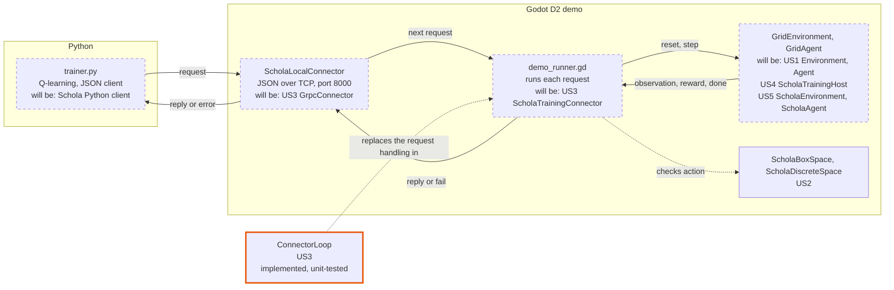
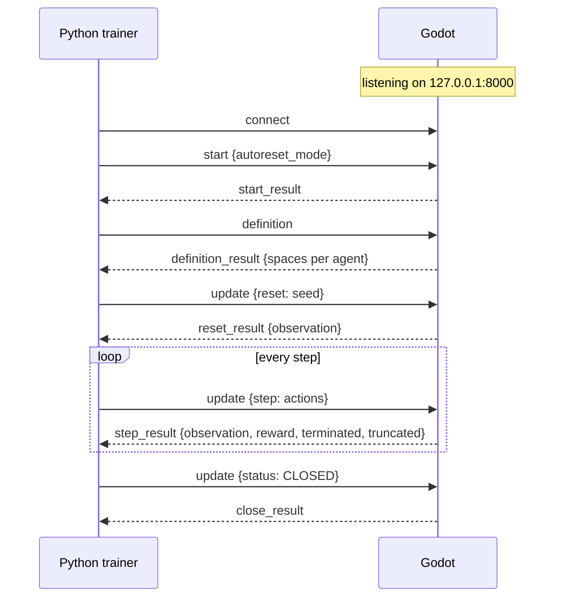
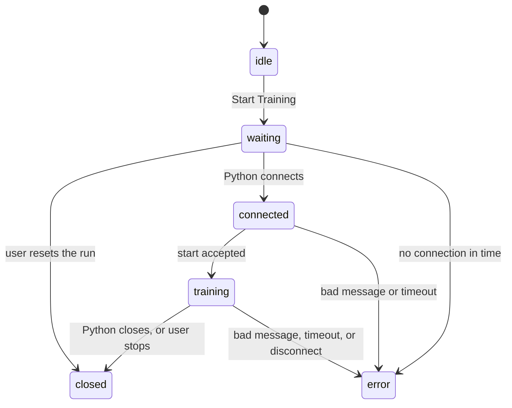

# Local training protocol (D2)

The D2 demo connects Godot to a local Python trainer with newline-delimited JSON over localhost TCP. It is a stand-in for US3's gRPC connector. It carries the same calls, in the same order, as Schola's `GymService` (`Proto/GymConnector.proto`).

- **Godot** (`ScholaLocalConnector`, `d2_demo/addons/schola_d2/transport/`) listens on `127.0.0.1:8000`.
- **Python** (`d2_demo/python/trainer.py`) connects and sends every request, one at a time. Godot only answers.

## Where US3 fits in the demo

The diagram shows what runs in the demo today. `ConnectorLoop` is the US3 code implemented so far. The dashed boxes are temporary stand-ins, each labelled with the user story and component that will replace it.



| Component | In the demo today | Will be replaced by | File |
| --- | --- | --- | --- |
| `ConnectorLoop` | **US3, implemented.** Runs a session in the Python client's order and routes each request to the backend. Covered by 18 unit tests; not yet wired into the demo. | — | `Godot/src/core/connector/connector.cpp` |
| `trainer.py` | **Stand-in.** Q-learning plus a JSON client that sends start, definition, reset, step and close. | Schola's existing Python client (`GymEnv`) with a training library such as Stable-Baselines3 | `d2_demo/python/trainer.py` |
| `ScholaLocalConnector` | **Stand-in.** Receives Python's requests over JSON/TCP, rejects invalid ones, sends replies, and tracks the connection state. | US3: `GrpcConnector`, a `Connector` over gRPC | `d2_demo/addons/schola_d2/transport/schola_local_connector.gd` |
| `demo_runner.gd` (request handling) | Stand-in. Takes one request per step, runs it on the environment, and answers. | US3: `ScholaTrainingConnector` driving `ConnectorLoop`, which reaches the game through US3's `HostTrainingBackend` | `d2_demo/addons/schola_d2/runtime/demo_runner.gd` |
| `GridEnvironment`, `GridAgent` (on `ScholaDemoEnvironment`, `ScholaDemoAgent`) | Stand-ins. Move the agent, build its observation, compute the reward, and end episodes. | US1: `Environment`, `Agent`; US4: `ScholaTrainingHost` and the episode lifecycle; US5: `ScholaEnvironment`, `ScholaAgent` nodes | `d2_demo/demo/`, `d2_demo/addons/schola_d2/nodes/` |
| `ScholaBoxSpace`, `ScholaDiscreteSpace` | **US2, real.** Describe the observation and action shapes and check each action. | — | `Godot/src/bindings/spaces/` |

The unit tests use two more stand-ins so `ConnectorLoop` runs without Python or Godot: `FakeConnector` takes the place of US3's `GrpcConnector`, and `FakeTrainingBackend` takes the place of US4's `TrainingBackend` (reached through `HostTrainingBackend`).

## Session



## Messages

Environment IDs are positions (`"0"` is the first). Agent IDs come from each agent node (`agent_0` in the demo).

| Python sends | Godot replies |
| --- | --- |
| `{"type": "start", "autoreset_mode": "DISABLED"}` | `{"type": "start_result"}` |
| `{"type": "definition"}` | `{"type": "definition_result", "environments": [{"agent_0": {"observation_space": {...}, "action_space": {...}, "agent_type": ""}}]}` |
| `{"type": "update", "reset": {"environments": {"0": {"seed": 1234, "options": {}}}}}` | `{"type": "reset_result", "initial_state": {"0": {"agent_0": {"observation": [1, 3, 4, 0], "info": {}}}}}` |
| `{"type": "update", "step": {"actions": [{"agent_0": 3}]}}` | `{"type": "step_result", "state": [{"agent_0": {"observation": [...], "reward": -0.1, "terminated": false, "truncated": false, "info": {"outcome": "running"}}}], "initial_state": {}}` |
| `{"type": "update", "status": "CLOSED"}` | `{"type": "close_result"}` |

Spaces use US2's dictionary format, e.g. `{"type": "Discrete", "n": 4}`. Python checks each action against the action space before sending it. Python may also send `progress`, `saved`, and `log` messages for the demo's panel; Godot does not reply to those.

## Errors

A failed request gets an error instead of its reply, and Godot then closes the connection:

```json
{"type": "error", "code": "INVALID_ARGUMENT", "message": "Environment 0 has no agent \"agent_9\"; its agents are [\"agent_0\"]."}
```

| Code | When |
| --- | --- |
| `INVALID_ARGUMENT` | Message is not JSON, unknown type, missing field, unknown environment or agent, action outside the space |
| `FAILED_PRECONDITION` | A valid argument but at the wrong moment. e.g. `update` before `start`, or stepping a finished episode. |
| `INCOMPATIBLE` | `autoreset_mode` other than `DISABLED` |
| `TIMEOUT` | Python quiet too long: 45 s to connect and start, 60 s during training (set on the `Runner` node) |
| `RUNTIME_FAILURE` | The game failed to reset or step |
| `CLOSED` | The user pressed **Stop / Reset Run**. Python saves its policy and closes; the connection stays open for that. |

## Connection states

Shown in the demo's log panel and emitted as `connection_state_changed` on the `Runner` node.



## D2 limits

One environment, one agent, Box and Discrete spaces, `DISABLED` auto-reset only. US3 is partially complete in D2: same calls and roles as gRPC, but not the unmodified Schola Python client.

## Moving to gRPC

`ScholaLocalConnector` uses the same method names as the C++ `Connector` in `Godot/src/core/connector/connector.h` (`open`, `reply_start`, `publish_definition`, `reply_reset`, `reply_step`, `fail`, `close`). `ConnectorLoop`, which drives a `Connector` in this same order, is implemented and tested in `Godot/tests/unit/connector_loop_test.cpp`. Switching to `GrpcConnector` changes only the transport.
