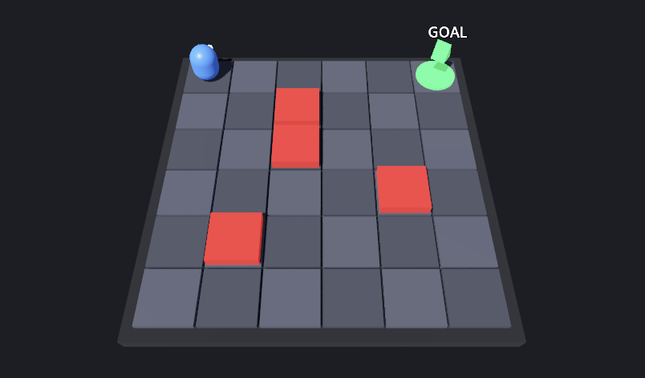

# Schola for Godot

Schola for Godot is a Godot 4.7 port of AMD's Schola reinforcement-learning toolkit, developed by CSC301 Team 20 in partnership with AMD. The project gives Godot developers engine-native building blocks for defining reinforcement-learning environments, training agents through Python, and running exported ONNX policies without a live training process.

## Partner introduction

AMD maintains the open-source Schola reinforcement-learning toolkit and is the partner organization for this project.

- **Primary contact:** Alexander Cann, Member of Technical Staff, [alexander.cann@amd.com](mailto:alexander.cann@amd.com)
- **Secondary contact:** TianYue "Michael" Liu, Senior Software Engineer, [tianyliu@amd.com](mailto:tianyliu@amd.com)

## Project description and value

AMD Schola currently connects Unreal Engine environments to Python reinforcement-learning frameworks. This project brings the same workflow to Godot: developers define environments and agents with engine-native APIs, train them through Schola's Python tooling, export trained policies to ONNX, and run those policies inside Godot without shipping Python. The port avoids requiring each Godot developer to build custom training transport, episode coordination, and inference infrastructure.

## Key features

- **Godot-native environment definition:** Configure environments and agents through Godot nodes and the Inspector.
- **Typed observation and action spaces:** Represent and validate Box, Discrete, MultiDiscrete, MultiBinary, and Dict values.
- **Python training integration:** Exchange environment definitions, observations, actions, rewards, and episode state with Python trainers.
- **Episode lifecycle coordination:** Handle resets, steps, terminal states, truncation, autoreset, and multiple environments.
- **Local ONNX inference:** Run exported policies in Godot without an active Python process or training connection.
- **Separable packaging:** Exclude training-only dependencies from games that need inference only.

## D2 product

The D2 release includes a playable 3D grid-world that demonstrates the intended workflow:

1. A Godot environment exposes observations, actions, rewards, and episode completion.
2. A local Python trainer learns a policy while Godot displays episode rewards and connection status.
3. The trained policy is exported to ONNX.
4. Godot loads the ONNX model and runs inference with Python closed.

The demo combines production components with temporary integration code. Its space resources and validation use the US2 C++ implementation, and ONNX loading and inference use the US7 C++ implementation with ONNX Runtime 1.30. The Godot environment nodes, episode lifecycle, and localhost training connector are GDScript stand-ins for the unfinished US1, US3, US4, and US5 integration. The connector uses JSON over local TCP rather than the planned gRPC transport. The production US4 lifecycle is implemented and tested on the release branch but is not called by the demo scene.

## Instructions

The packaged Windows, Linux, and macOS demos require no source checkout or development tools for the inference workflow. Download and launch instructions are in [Deployed URL and access instructions](#deployed-url-and-access-instructions).

Inside the demo:

- Use the arrow keys to move the agent manually.
- Select **Load ONNX Policy** to run the exported policy locally through ONNX Runtime.
- Select **Stop / Reset Run** to return the environment to its initial state.
- Select **Test US2 validation** to display rejected action and observation values.

Training requires the developer setup because the D2 trainer runs as a local Python process. The complete build, training, and troubleshooting instructions are in the [D2 demo guide](Godot/demo/d2/README.md).

## D1 prototype

The earlier D1 interface prototype is preserved in [`Godot/demo/d1`](Godot/demo/d1), with a [video walkthrough on YouTube](https://youtu.be/zg4K3fiQjJw). It demonstrates configurable Godot environment and agent nodes, reward feedback, episode limits, and resets. It uses C# to prototype the interface and does not include a training backend or persistence; the production architecture uses C++ GDExtensions.

## Key use cases

### Define an environment

The core API represents agents, environments, interaction definitions, and typed observation and action spaces. Godot-facing environment nodes remain integration work after D2.

### Execute an episode

The lifecycle and coordinator validate agent results, track episode steps, handle terminal and truncated states, apply autoreset behavior, and preserve a stable environment order for a training session.

### Train from Python

The D2 demo sends definitions, resets, observations, rewards, and actions between Godot and a local tabular Q-learning trainer. The production connector loop is implemented and tested, while the final gRPC adapter remains future work.

### Run a policy in Godot

The runtime loads ONNX models, validates model inputs and outputs, maintains per-agent recurrent state, converts Godot values at the inference boundary, and executes policies without Python.

## Project structure

- [`Godot/src`](Godot/src) contains the production C++ core, Godot bindings, interoperability code, connector, lifecycle, and inference modules.
- [`Godot/demo/d2`](Godot/demo/d2) contains the D2 training and inference demonstration.
- [`Godot/demo/d1`](Godot/demo/d1) preserves the earlier C# interface prototype.
- [`Godot/tests`](Godot/tests) contains core, inference, and Godot integration tests.
- [`deliverables`](deliverables) contains course planning, reviews, contribution records, and meeting minutes.

See the [Godot development guide](Godot/README.md) for the supported toolchain, dependency pins, build commands, test commands, module boundaries, and packaging design. The full MVP and acceptance criteria are recorded in the [D1 planning document](deliverables/D1/planning.md).

## Development requirements

Production development targets Godot 4.7.2 and C++17 GDExtensions. The repository pins `godot-cpp`, Catch2, GdUnit4, SCons, formatting tools, and ONNX Runtime versions. Building from source requires Git submodules, Python, SCons, a supported C++ compiler, and Godot; platform-specific commands are documented in the [Godot development guide](Godot/README.md#build-and-run).

The architecture keeps reusable core logic independent from Godot, gRPC, Protocol Buffers, and ONNX Runtime. Training communication will use Schola's gRPC protocol, while exported policies use ONNX Runtime through the inference-only runtime add-on.

## Deployment and GitHub workflow

The D2 product is distributed as a versioned GitHub release with packaged Windows x86_64, Linux x86_64, and macOS arm64 demos. The production library is designed as separate runtime and training add-ons so exported games can omit training-only dependencies.

Work is divided by user story and developed on named branches. Changes enter shared branches through pull requests, where another team member reviews the code and GitHub Actions checks formatting, native builds, unit tests, and Godot integration tests. Commit messages follow Conventional Commits, using prefixes such as `feat:`, `fix:`, `docs:`, and `test:`. Cross-story API or protocol changes are discussed with their producers and consumers before merge. The team tracks ownership and progress on [Trello](https://trello.com/b/Ry0Qkx2R).

## Coding standards and guidelines

C++ follows Godot's C++ style and the repository's pinned `clang-format` configuration. Python follows PEP 8 and is formatted with Black. New behavior requires focused tests, generated Protocol Buffer files must not be edited by hand, and engine-independent core code must not depend on Godot or transport libraries. The complete rules are in [`CONTRIBUTING.md`](CONTRIBUTING.md) and the [Godot development contract](Godot/docs/development_contract.md).

## License

The project uses the [MIT License](LICENSE.txt), matching AMD Schola. It permits reuse, modification, and redistribution while requiring preservation of the copyright and license notice.

## Deployed URL and access instructions

The packaged demos are published with the [D2 GitHub release](https://github.com/csc301-2026-f/20-AMD-Schola/releases/tag/D2). Download the archive for Windows x86_64, Linux x86_64, or macOS arm64; extract it if necessary; and run the included application. The release is a fixed D2 snapshot, so later development will not change the submitted product.

The packaged application includes a reference policy and supports manual control, space validation, and local ONNX inference. Running a new training session requires the developer setup described in the [D2 demo guide](Godot/demo/d2/README.md) because the trainer is a local Python process.

## Project resources

- [D2 iteration review](deliverables/D2/iteration-02-review.md)
- [D2 individual contributions](deliverables/D2/Individual_Contributions_Deliverable2.md)
- [D2 demo guide](Godot/demo/d2/README.md)
- [D1 interactive prototype](Godot/demo/d1)
- [D1 prototype video](https://youtu.be/zg4K3fiQjJw)
- [Godot development guide](Godot/README.md)
- [D1 planning document](deliverables/D1/planning.md)
- [Architecture diagram](deliverables/D1/d1-architecture-diagram.png)
- [Team and stakeholder records](deliverables/team/)
- [Meeting minutes](deliverables/team/minutes/)
- [Trello board](https://trello.com/b/Ry0Qkx2R)

## D3 improvement highlight

The D3 product-evolution report will compare the D2 release with the next integrated version. Its template is in [`deliverables/D3/product-evolution.md`](deliverables/D3/product-evolution.md).
